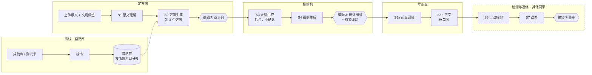
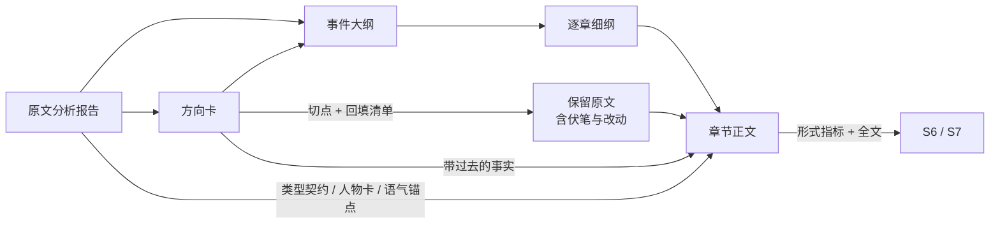

# 三、Agent 核心架构

**一句话：先读懂原作，在同一个情感基调里组合出三个续写方向，编辑选定后，系统在后台排出事件大纲，再细化成逐章细纲交编辑确认，最后逐章写成正文。** 每一步的产出都是结构化数据，并由代码检查；正文写完后交给自动校验（S6）和返修（S7），这两步由其他同学负责。

本节只写生成段（S1～S5）。prompt 全文在 demo 的 `prompts/` 目录里，这里只写要点和版本号。

## 3.1 设计原则

| # | 原则 | 为什么 |
|---|---|---|
| 1 | **续写，不是扩写。** 切点前的原文基本不动：剧情只多不少，改动不超过前文的 5%（插入的伏笔另算）；改动在细纲确认时标出来给编辑看 | 原作已经过编辑精选。改动要能让读者觉得新反派、新谜团是早有铺垫的，但不能伤到原作 |
| 2 | **情感基调不变。** 由原文理解认定，全流程都受它约束 | 第一轮评测里，问题最集中的就是把复仇爽文写成了女性成长。编辑的建议是现阶段留在原题材大类里 |
| 3 | **方向 = 对手 × 交锋方式 × 反转 × 结局。** 三个方向两两至少有两项不同；切点只是方向的一个属性 | 编辑能分辨的是差别明显的方向。原来用切点区分的三条路线经常只剩两条，而且彼此差别很小 |
| 4 | **不丢、新高。** 被删掉的原作高光只能保留或加码；终局高光不低于原作最强的那段 | 续写成品要比原作更好看，至少不能更差 |
| 5 | **控事件密度，不只控字数。** 章长、对话占比、章尾落在事件上，都对照原文量化 | 编辑的原话：原文 600 字的信息量，我们写成 1800 字，三分之二都是水 |
| 6 | **写作和检查分开，质量判断不触发自动重写。** 代码查可以客观核对的问题，质量问题交给编辑 | 此前用质量判断触发整章重写，重写不收敛 |
| 7 | **若非必要，勿增实体。** 不给写作喂故事档案，不让模型给方向打分 | 每加一个机制，都要有编辑反馈证明它有用 |

## 3.2 架构总览

图例：菱形是停下来等编辑的节点（AI 直出模式下跳过①②）；虚线框由其他同学负责。

| 阶段 | 职责 | 主要输入 | 主要输出 | 停下等人 | 调用次数 |
|---|---|---|---|---|---|
| S1 原文理解 | 读懂原作：类型、情感基调、高光、可续素材 | 原文、文纲标签 | 原文分析报告 | 否，编辑只看 | 1 |
| S2 方向生成 | 决定从哪切、后两万字写成什么故事 | 原文分析报告、原文、套路库 | 3 张方向卡 | 是（编辑①） | 1，自动选再加 1 |
| S3 大纲生成 | 把方向排成两万字的事件结构和节奏 | 选定方向、原文分析报告 | 事件大纲 | 否 | 1，没排满时重跑 1 次 |
| S4 细纲生成 | 定下每章写什么、在哪收尾 | 事件大纲、方向、人物卡 | 逐章细纲 | 是（编辑②） | 1 |
| S5a 前文调整 | 在切点前的原文里补伏笔、做小改 | 方向卡里的回填清单、原文 | 调整后的保留原文 | 随编辑②一起确认 | 1 |
| S5b 正文生成 | 按细纲逐章写 | 保留原文、已写前章、本章细纲 | 逐章正文和形式指标 | 否，可随时停止 | 每章 1 |

一本书约 25 次调用（按续写 20 章算）。

## 3.3 核心数据对象

研发建表、写接口以这一节为准。字段名以 demo 的 JSON 为准，下表只列关键字段。

关键点：**切点决定后面各阶段能看到多少原文。** 切点之后被删的章节，后续阶段看不到；需要用到的事实，必须写进方向卡的"带过去的事实"。

| 对象 | 关键字段 | 产出 | 使用方 |
|---|---|---|---|
| 原文分析报告 | 类型契约（类型、情感基调、核心情绪、读者期待、反派应有下场、禁止走向）；事件结构（大事件、逐章小事件、章尾类型）；高光（章、类型、强度 1～5）；低谷；主线收完的章；可续线索（类型、依据、强度）；人物卡（行为特征附依据）；语气锚点（逐字原句） | S1 | S2～S5，以及工作台左栏的"原文大纲 / 人物关系 / 伏笔清单" |
| 方向卡 | 给编辑看：梗概、核心事件及各占几章、四个要素（对手、交锋方式、反转、结局，每项标出套路 id、本书里怎么做、原作已有还是续写新加）、重要新角色、反派下场、终局高光。给机器用：切点和保留比例、被删高光的处理、所用线索、带过去的事实、伏笔回填清单 | S2 | 编辑①、S3、S4、S5a、S5b |
| 事件大纲 | 大事件（起止章、场景、小事件、作用）、第二冲突亮出的章、高潮分布、高光落在哪章、伏笔在哪章回收、人物弧线 | S3 | S4 |
| 逐章细纲 | 每章：标题、人物、地点、时间、事件（各附与主线的关系）、核心冲突、解决了什么、预告、章尾钩子（类型只能是事件或对话）、目标字数；新角色卡 | S4 | 编辑②、S5b |
| 章节正文 | 正文、所用模型、prompt 版本；形式指标（字数、对话占比、段落均长、和前文重复的句子、口头禅）；修改前的版本 | S5b | 编辑、S6、S7 |

## 3.4 各阶段设计

每个阶段按同一个格式写：做什么 → 关键规则 → 代码检查与失败处理 → prompt。**模型负责的部分可以靠改 prompt 调；代码负责的部分是确定的逻辑，由研发实现。**

### S1 原文理解

- **做什么**：一次读完全文，产出原文分析报告。形式基线（章长中位数、对话占比、段落均长、叙事人称）由代码计算，不让模型估。
- **关键规则**
  - 情感基调从套路库已有的基调里选，选不出就写"其他：xxx"。
  - 高光不只看爽点，情感高光和反转也算，强度统一按 1～5 打分。
  - 可续线索只从五类里找：漏网反派、没兑现的狠话、埋了没用的设定或谜团、提过没展开的人物、主角软肋。每条都要附原文依据。
  - 和文纲标签不一致时，标出来。
- **代码检查**：语气锚点必须逐字出自原文；主线收完的章号在合法范围内；逐章事件覆盖全部章节。不通过时只提示，不拦流程。
- **prompt**：`s1_understand.md`（2026-10-29.wb.2）

### S2 方向生成

- **做什么**：出 3 张方向卡，每张由四个要素组合，并自带切点。
- **关键规则**
  - 切点不晚于主线收完的那一章；保留的原文不少于 60%。
  - 三个方向两两之间，至少有两个要素不同。
  - 第二冲突必须来自强度 ≥ 3 的可续线索；新人物只能挂在某条线索上。
  - 被删的原作高光，每一条都要写清怎么处理：保留、挪后还是加码。加码要写明维度（赌注更大、反派地位更高、场合更公开、反派损失更彻底、叠加情感高光）。
  - 套路库有三种用法：库优先、允许 AI 补充（默认）；只用库；不用库。没有引用库里套路的要素，在卡片上标"AI 新想法"。
  - 差异拉不开时宁可少给，在说明里写原因，不硬凑。
- **代码检查**：切点、保留比例、高光处理是否覆盖全部被删高光、线索强度、新人物是否挂在线索上、四个要素是否填齐、引用的套路是否在库里、两两差异是否够。不通过的项在卡片上标红，编辑仍然可以选。
- **配套能力**
  - 编辑自定义：编辑写一句想法，由 AI 补成完整的方向卡（`s2_custom.md`）。
  - 自动选方向：用于 AI 直出模式，见 3.5（`s2_select.md`）。
- **prompt**：`s2_directions.md`（2026-10-29.wb.2）

### S3 大纲生成（后台，不确认）

- **做什么**：把选定方向排成事件级大纲。章数 = 目标字数 ÷ 原文章长中位数（约 1000 字，两万字约 20 章）。
- **关键规则**
  - 大事件首尾相接，覆盖全部章节。一组小事件做完才换场景，像游戏做完小任务再换地图。
  - 第二冲突最晚在续写的前四分之一亮出；中段安排 1～2 个小高潮，终局高光放在最后 2～3 章。
  - 爽文里主角受压到翻盘不超过 2 章；虐文、追妻火葬场按原作节奏。
  - 被删的高光、补的伏笔，都要落到具体章节。
  - 反派转变要有过程：先嘴硬、被打脸，最后才服软。
- **代码检查**：大纲没覆盖全部章节时自动重跑一次，仍不行就报错停下。原因是大纲不经过编辑确认，漏排的章节会悄悄流到细纲。
- **prompt**：`s3_outline.md`

### S4 细纲生成（编辑②确认）

- **做什么**：逐章写清人物、地点、时间、事件、冲突、钩子。这是编辑判断方向和人设对不对的主要依据，所以不能一句话带过。
- **关键规则**
  - 每个事件都要写明和主线的关系，和主线无关的内容不排进细纲。
  - 章尾钩子只能落在事件或对话上。
  - 扩写靠增加新事件，不靠把一个事件拉长。
- **代码检查**：细纲没覆盖全部章节时，不允许确认；钩子类型合法、内容非空。每章的事件数先不卡，原因见 3.9。
- **prompt**：`s4_detail.md`

### S5a 前文调整

- **做什么**：按方向卡里的回填清单，在切点前的原文里补伏笔、做小改。
- **关键规则**
  - 剧情只多不少，改动不超过前文的 5%（伏笔另算）。
  - 免费章只加伏笔、不改原句（**待和运营确认**）。
- **代码检查**：模型只输出"锚点句 + 插入内容"，由代码插入原文。锚点必须在该章里唯一，否则不插入并提示。所有改动在细纲确认页的原文里高亮，交给编辑看。
- **prompt**：`s5a_backfill.md`。demo 目前只支持插入，"改原句"还没实现。

### S5b 正文生成

- **做什么**：按细纲逐章写，每章都看到全部保留原文和已写的前章（全文注入）。写完一章立刻计算形式指标，然后写下一章，不停下等确认，编辑可以随时停止。
- **关键规则**
  - 字数在原文章长中位数的 70%～150% 之间。对话占比和段落长度贴近原文，叙事人称一致。
  - 章尾落在钩子上。
  - 写法要求放在 prompt 末尾：编辑归纳的 AI 味反例、神态小动作的上限、一章只收一次尾。实测放在末尾对 flash 有效。
- **代码检查**：字数、对话占比、段落均长、和前文原样重复的句子（8 字以上完全相同）、口头禅。不通过的只提示，编辑可以：
  - 按预填的意见修改，可恢复到修改前；
  - 整章重写；
  - 多模型对比：2～4 个模型同时写这一章，并排挑一版。
- **自动修改**：开关默认关闭。原因有二：打开后就不是直出，没法单独评估写作这一步；而且和 S7 返修重叠。
- **为什么全文注入，不用 PRD 原来的"滑动窗口 + 摘要"**：前后文一共只有 3 万字，模型装得下。摘要会丢失细节，反而造成前后矛盾。
- **prompt**：`s5b_write.md`（2026-10-28.wb.3）、`s5c_revise.md`（按意见修改）

## 3.5 编辑介入与 AI 直出

| 节点 | 人工确认模式 | AI 直出模式 |
|---|---|---|
| 编辑① 方向 | 三选一；或自己写一句想法，由 AI 补成方向卡；或否决（从固定理由里选） | AI 自动选，并写出理由 |
| 大纲 | 不确认，后台生成 | 同左 |
| 编辑② 细纲 | 逐章确认或修改，同时确认前文改动 | 自动通过 |
| 正文 | 连续写，可停止、手改、按意见修改、重写、多模型对比 | 连续写 |
| 编辑③ 终审 | 编辑终审（在 S6/S7 之后） | 同左 |

- **三层都能调整。** 方向、细纲、正文三层，每层都可以：让 AI 给几个可选的改法；编辑自己写意见；或者一次出多个版本来挑。方向层的可选改法优先从套路库里取，例如"换一个反转"就列出库里还没用过的反转。
- **改了上游时的处理。** 保存时提示可能影响下游哪些内容，由编辑决定是否重写，不自动清掉下游。
- **AI 自动选方向的过渡规则。** 按顺序比较，前一条分出高下就不再看后一条：
  1. 是否守住类型、有没有出现禁止的走向；
  2. 新冲突在原文里有没有依据；
  3. 终局是否比原作更强；
  4. 被删的高光是否都有去处。

  等编辑的选择数据积累起来，再改成按套路的被选率来选。
- **记录。** 编辑每一次选择、否决、修改的前后版本和意见原文都要存下来，这是以后校准自动选择和评测的数据。

## 3.6 套路库（离线链路）

- **是什么**：方向四要素的可选项，按情感基调分表。每条套路记录：适用基调、所属要素、一句话做法、需要原作提供的前提、前文要埋的伏笔、禁忌、来源。
- **从哪来**：三类来源：拆书（参考稿库到位后）、编辑抽取、AI 自拟。第一版是用 8 本测试书拆出来的复仇爽文 29 条，只写通用做法、不含原文情节，**还没经过编辑审核**。追妻火葬场要等测试书到位再做。
- **怎么进化**：按套路统计编辑的被选率，长期不被选的降权；AI 的新想法多次被选，就收进库里。
- **四个要素是否完整**：拆书时塞不进四类的内容都记在"其他"栏里。目前反复出现两类：主角底牌（01、04、06、07）和情感锚点（01、05、06、07），可能需要补成新要素，待定。

## 3.7 与其他部分的接口

**交给 S6 校验和 S7 返修的内容**：逐章正文；每章的形式指标；事实来源（原文分析报告里的人物卡和原文依据、方向卡里带过去的事实、逐章细纲），用来做一致性比对；原文基线。

**对第二部分产品流程的修改建议**

| 现在 PRD 里的写法 | 建议改成 | 原因 |
|---|---|---|
| 原文理解锁定"原文结尾过渡点" | 切点由每个方向自己定 | 不同方向适合不同切点 |
| 3 个方向，各含核心冲突、新地图、主角新目标 | 方向卡按 3.3 的字段，以四个要素为主 | 编辑要能直接比较方向之间的差别 |
| 状态"待确认大纲" | 改为"待确认细纲"；大纲在后台生成 | 编辑要看到每章写什么才能判断；一句话的章纲会误导编辑（编辑原话："看纲 4 分，看正文 1.5 分"） |
| 每章 2000～3000 字，"3 章一小爽、5 章一大反转" | 按原文章长中位数（约 1000 字）；节奏由大纲按事件排 | 编辑明确要求单章长度和原文一致 |
| 正文"滚动上下文窗口 + 前文摘要记忆" | 全文注入 | 见 S5b |

## 3.8 模型、成本与耗时

每个阶段都可以单独配模型，统一通过 OpenRouter 调用。以下数据来自 demo 实测，样本是《穿成全网群嘲明星》，续写 20 章。

| 项目 | 实测 |
|---|---|
| 全流程耗时（deepseek v4.1 flash） | 约 11 分钟 |
| 正文 20 章的费用 | flash 约 $0.1，gemini 约 $1.2，gpt 约 $1.5 |
| 和前文重复的句子（4 章合计） | flash 14～23 处，gemini 1～2 处，gpt 0～1 处 |
| 多模型对比写一章（三个模型并行） | 约 35 秒 |

建议：理解、方向、大纲、细纲先用 flash。正文的模型等编辑读过三个模型的样章后再定：gpt 最干净，但爽感偏弱；gemini 最像爽文，但会写出违法手段；flash 便宜，但重复和 AI 腔明显。

## 3.9 已验证、待验证、待决

**已验证**（demo 实测）

- 流程能端到端跑通，各阶段代码检查全部通过（flash，全流程约 11 分钟）。
- 四要素出方向：同一本书，三条路线只出得了两个方向，四要素出齐三个，两两之间都有 3 个要素不同。
- "不要重复前文"写在 prompt 里，对 flash 无效；把写法要求挪到 prompt 末尾，重复从 22 处降到 15 处。重复问题更适合由代码查出来，再定向修改。
- 事后压缩字数不可靠：11 章里只有 3 章压到了上限以内。字数要在写初稿时控制。

**待验证**（需要编辑判断）

- 方向本身好不好；套路库三种用法之间的对比。
- 细纲能不能让编辑准确判断正文的好坏。

**待决**

| 问题 | 谁来定 |
|---|---|
| 免费章能不能改原句 | 产品和运营 |
| "事件"的口径：编辑估计每章约 1.3 个，模型统计约 7 个；在口径定下来之前，细纲不卡事件数 | 产品和编辑 |
| 四要素要不要补"主角底牌""情感锚点" | 拆完更多书后统计 |
| 套路库由谁审、谁拍板收录 | 产品和编辑 |
| 套路标签清单、参考稿库、追妻火葬场测试书的到位时间 | 编辑侧 |
| 正文默认用哪个模型 | 编辑读样章后定 |
